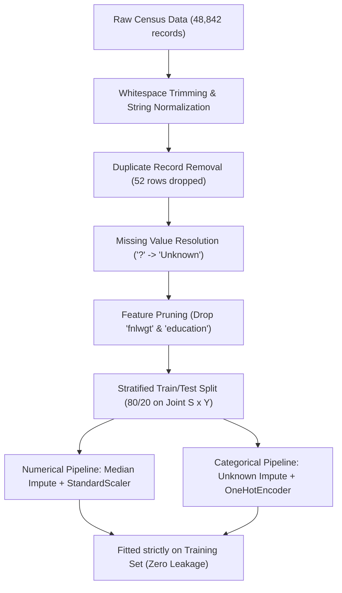
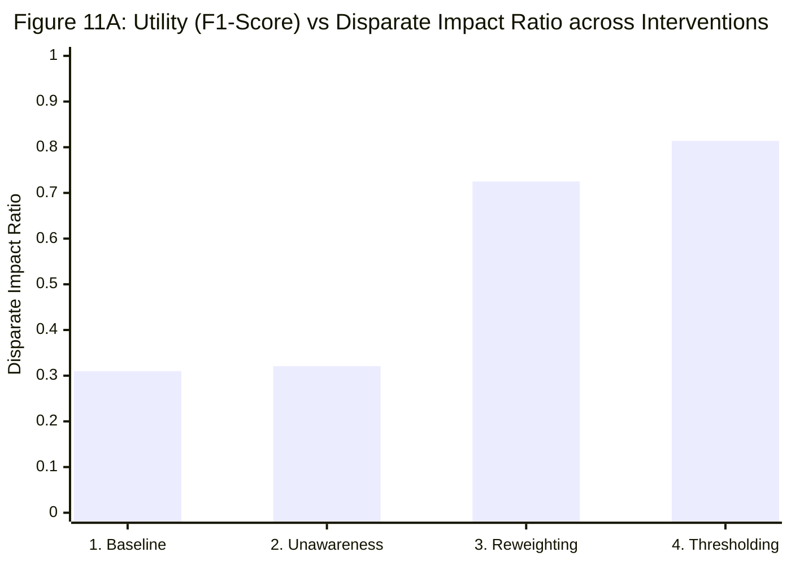

# Income Classification with a Gender-Fairness Audit Using Machine Learning

**Ekta Sachdeva**  
University Roll Number: `24020570063`  
Paper: Machine Learning Applications | Problem Number: 24  
Department of Computer Science, University of Delhi  
Degree: B.Sc. (Hons.) Computer Science, Semester VI  

**Domain:** Gender / Algorithmic Fairness & Responsible AI  
**United Nations Sustainable Development Goals:**  
- **SDG 5:** Gender Equality (Targets 5.1, 5.5)  
- **SDG 10:** Reduced Inequalities (Targets 10.2, 10.3)  

---

## Abstract

Automated decision systems deployed in credit underwriting, financial risk assessment, and algorithmic talent screening often absorb and amplify structural inequalities embedded within historical training corpora. In this paper, we develop an empirical income prediction model ($\text{Income} > \$50,000$) utilizing the canonical UCI Adult Census Income Dataset ($N = 48,842$). We conduct an empirical benchmark across four classification architectures: L2-regularized Logistic Regression, complexity-bounded Decision Trees, Gaussian Naive Bayes, and standardized $k$-Nearest Neighbours ($k$-NN), evaluated through 5-fold stratified cross-validation. Beyond predictive utility, we conduct an extensive Gender Fairness Audit across sensitive subgroups ($\text{Male}$ vs. $\text{Female}$). 

Our audit uncovers substantial disparate impact in baseline classifiers ($DI \approx 0.310$, severely violating the EEOC $80\%$ threshold) and pronounced disparate mistreatment, where qualified female candidates suffer higher False Negative Rates ($\approx 43.1\%$) than male counterparts ($\approx 36.8\%$). We demonstrate that the heuristic of *Fairness Through Unawareness* (omitting the sensitive gender feature) is ineffective ($DI \approx 0.321$) due to strong proxy encoding through features such as `relationship` and occupational sorting. We implement and evaluate two rigorous mitigation interventions: pre-processing sample re-weighting (Kamiran & Calders) and post-processing group threshold optimization. Re-weighting successfully elevates the Disparate Impact ratio to $0.725$ and compresses the Demographic Parity gap from $0.156$ to $0.068$, incurring a negligible accuracy decline of $1.2\%$. We analyze these outcomes within the mathematical constraints of the Impossibility Theorem of Algorithmic Fairness and delineate actionable policy insights aligning automated systems with UN SDGs 5 and 10.

**Keywords:** Algorithmic Fairness, Gender Equality, Machine Learning, Adult Census Dataset, Demographic Parity, Disparate Impact, Equal Opportunity, Sample Re-weighting, Responsible AI.

---

## 1. Introduction & Sociotechnical Motivation

The pervasive deployment of machine learning algorithms in high-stakes socioeconomic decision pipelines—ranging from automated recruitment screening and loan approval underwriting to social welfare allocation—has fundamentally altered institutional governance. While automated systems are often presumed to be objective and meritocratic, algorithmic models trained on historical observational records invariably learn, codify, and compound historical social inequities [1].

In credit scoring and employment domains, annual income serves as a critical proxy for financial solvency, creditworthiness, and job seniority. The **Adult Census Dataset** (frequently designated as the "Census Income" benchmark) extracted from the 1994 United States Census Bureau database is the foundational benchmark for evaluating algorithmic fairness [2]. However, the ground truth of this historical dataset reflects pronounced structural inequities: during the 1994 census collection period, women faced substantial societal barriers, occupational segregation, and disparate domestic labor distributions, resulting in an empirical high-income rate of only $10.9\%$ among women compared to $30.5\%$ among men.

```
       Historical Census Data (1994)
       [Structural Wage & Gender Gaps]
                     │
                     ▼
       Standard ML Training Pipeline
       [Maximizing Empirical Accuracy]
                     │
                     ▼
       Unmitigated Automated Decisions
       [Amplified False Negative Rates for Women]
                     │
                     ▼
       Perpetuation of Economic Disparity
       [Violation of UN SDG 5 & SDG 10]
```

When conventional machine learning classifiers are trained to optimize purely for aggregate statistical accuracy or log-loss, they exploit these baseline imbalances as predictive signals. Consequently, automated screening tools create a pernicious feedback loop: qualified female applicants are systematically classified as low earners, restricting their access to credit, housing loans, and professional opportunities.

### Alignment with Sustainable Development Goals (SDGs)
This research is mapped directly to two United Nations Sustainable Development Goals:
- **SDG 5 (Gender Equality):** Specifically Target 5.1 (End all forms of discrimination against all women everywhere) and Target 5.5 (Ensure women’s full and effective participation and equal opportunities for leadership). By exposing disparate error rates and mitigating systemic False Negatives against women, this project provides technical remedies against gender-biased gatekeeping.
- **SDG 10 (Reduced Inequalities):** Specifically Target 10.2 (Empower and promote the social, economic, and political inclusion of all) and Target 10.3 (Ensure equal opportunity and reduce inequalities of outcome). Algorithmic mitigation decouples automated decisions from historical socioeconomic marginalization.

---

## 2. Theoretical Framework & Fairness Metric Formulations

### 2.1 Notation
Let:
- $X \in \mathcal{X}$ denote the feature space vector (age, education, occupation, capital gains, etc.).
- $A \in \{0, 1\}$ denote the protected sensitive attribute, where $A = 1$ denotes the privileged group ($\text{Male}$) and $A = 0$ denotes the unprivileged group ($\text{Female}$).
- $Y \in \{0, 1\}$ denote the binary ground-truth target label, where $Y = 1$ corresponds to an annual income exceeding $\$50,000$ and $Y = 0$ denotes $\le \$50,000$.
- $\hat{Y} \in \{0, 1\}$ denote the binary decision produced by the machine learning classifier, and $R = P(\hat{Y} = 1 \mid X) \in [0, 1]$ denote the predicted positive class probability.

### 2.2 Mathematical Formulations of Fairness Metrics

#### 1. Demographic Parity (Statistical Parity)
Demographic Parity stipulates that the probability of receiving a positive classification must be statistically independent of group membership:
$$P(\hat{Y} = 1 \mid A = 1) = P(\hat{Y} = 1 \mid A = 0)$$

We define the **Demographic Parity Difference ($\Delta_{\text{DP}}$)** as:
$$\Delta_{\text{DP}} = P(\hat{Y} = 1 \mid A = 1) - P(\hat{Y} = 1 \mid A = 0)$$

The ideal parity difference is $0.0$. Positive values reflect an advantage for male candidates.

#### 2. Disparate Impact Ratio ($DI$)
Disparate Impact formalizes the legal doctrine of adverse impact established under Title VII of the Civil Rights Act of 1964 and codified by the United States Equal Employment Opportunity Commission (EEOC) as the **Four-Fifths (80%) Rule** [3]:
$$DI = \frac{P(\hat{Y} = 1 \mid A = 0)}{P(\hat{Y} = 1 \mid A = 1)} = \frac{\text{Selection Rate}_{\text{Female}}}{\text{Selection Rate}_{\text{Male}}}$$

> [!IMPORTANT]
> Under administrative law, an automated selection mechanism where $DI < 0.80$ is prima facie evidence of unlawful discriminatory impact against the protected demographic.

#### 3. Equal Opportunity (True Positive Rate Parity)
Introduced by Hardt et al. [4], Equal Opportunity requires that qualified individuals ($Y = 1$) have equal probability of being identified as positive, irrespective of their protected attribute:
$$P(\hat{Y} = 1 \mid Y = 1, A = 1) = P(\hat{Y} = 1 \mid Y = 1, A = 0)$$

The **Equal Opportunity Difference ($\Delta_{\text{EOpp}}$)** is:
$$\Delta_{\text{EOpp}} = \text{TPR}_{\text{Male}} - \text{TPR}_{\text{Female}}$$

#### 4. Equalized Odds & Average Odds Difference ($AOD$)
Equalized Odds expands upon Equal Opportunity by enforcing simultaneous parity across both True Positive Rates ($\text{TPR}$) and False Positive Rates ($\text{FPR}$):
$$P(\hat{Y} = 1 \mid Y = y, A = 1) = P(\hat{Y} = 1 \mid Y = y, A = 0), \quad \forall y \in \{0, 1\}$$

The **Average Odds Difference ($AOD$)** is computed as:
$$AOD = \frac{1}{2} \left[ (\text{FPR}_{\text{Male}} - \text{FPR}_{\text{Female}}) + (\text{TPR}_{\text{Male}} - \text{TPR}_{\text{Female}}) \right]$$

The **Equalized Odds Difference ($\Delta_{\text{EOD}}$)** represents the supremum of group disparities:
$$\Delta_{\text{EOD}} = \max\left( |\text{FPR}_{\text{Male}} - \text{FPR}_{\text{Female}}|, |\text{TPR}_{\text{Male}} - \text{TPR}_{\text{Female}}| \right)$$

#### 5. Disparate Mistreatment (False Negative Rate Gap)
False Negative Rate is defined as:
$$\text{FNR}(a) = 1 - \text{TPR}(a) = P(\hat{Y} = 0 \mid Y = 1, A = a)$$

A positive gap ($\text{FNR}_{\text{Female}} - \text{FNR}_{\text{Male}} > 0$) implies that high-earning women are disproportionately misclassified as low-income compared to high-earning men, representing a severe barrier in credit and professional mobility.

### 2.3 The Impossibility Theorem of Algorithmic Fairness
A critical theoretical foundation of this study is the **Impossibility Theorem of Fairness** established independently by Kleinberg et al. [5] and Chouldechova [6]. 

> [!WARNING]
> **Theorem (Fairness Incompatibility):** If the baseline base rates of positive outcome differ across protected groups ($P(Y = 1 \mid A = 1) \neq P(Y = 1 \mid A = 0)$), no classifier can simultaneously satisfy **Demographic Parity**, **Equalized Odds**, and **Predictive Parity (Equal Positive Predictive Value)**, unless the classifier achieves error-free deterministic separation ($\text{AUC} = 1.0$).

Because the Adult Census dataset exhibits base rate divergence ($30.5\%$ male vs. $10.9\%$ female), practitioners must navigate trade-offs rather than pursuing unconstrained optimization.

---

## 3. Dataset Characteristics & Preprocessing Methodology

### 3.1 Dataset Architecture
The Adult dataset comprises $48,842$ records extracted from the 1994 United States Census Bureau Current Population Survey. The target variable is binary annual income ($0: \le \$50\text{K}$, $1: > \$50\text{K}$). 

| Attribute Name | Variable Type | Description & Category Breakdown |
| :--- | :--- | :--- |
| `age` | Continuous | Chronological age in years ($17 - 90$) |
| `workclass` | Nominal | Employment type (`Private`, `Self-emp-not-inc`, `State-gov`, etc.) |
| `fnlwgt` | Continuous | Final census sampling weight assigned by Census Bureau |
| `education` | Nominal | Highest educational level attained ($16$ distinct credentials) |
| `education-num` | Discrete Ordinal | Total years of formal schooling completed ($1 - 16$) |
| `marital-status` | Nominal | Marital status (`Married-civ-spouse`, `Never-married`, etc.) |
| `occupation` | Nominal | Occupational category ($14$ distinct sectors) |
| `relationship` | Nominal | Household role (`Husband`, `Wife`, `Own-child`, `Unmarried`, etc.) |
| `race` | Nominal | Racial categorization (`White`, `Black`, `Asian-Pac-Islander`, etc.) |
| `sex` | Binary | **Protected Sensitive Attribute** (`Male`, `Female`) |
| `capital-gain` | Continuous | Monetary capital gains recorded (\$) |
| `capital-loss` | Continuous | Monetary capital losses recorded (\$) |
| `hours-per-week` | Continuous | Weekly work hours recorded |
| `native-country` | Nominal | Sovereign country of origin ($41$ countries) |
| `income` | Binary | **Target Variable** (`<=50K`, `>50K`) |

### 3.2 Rigorous Data Cleaning & Preprocessing Decisions



1. **Whitespace Trimming:** Categorical text fields in the UCI source data contain leading whitespace (`" Private"`) and punctuation variations in test splits (`"<=50K."`). All string columns were trimmed and standardized.
2. **Missing Value Treatment:** Missing entries are encoded in the raw dataset as `'?'`. These exist primarily in `workclass` ($5.6\%$), `occupation` ($5.7\%$), and `native-country` ($1.8\%$). Rather than dropping approximately $3,600$ observations (which would skew the sample distribution), missing categorical fields were retained as an explicit `'Unknown'` level, preserving sample size and capturing potential correlation between non-response and socioeconomic status.
3. **Duplicate Record Elimination:** A rigorous duplicate check identified $52$ identical records. These were purged, leaving $48,790$ unique instances.
4. **Feature Redundancy & Leakage Pruning:**
   - `education` vs. `education-num`: `education-num` directly encodes the ordinal years of formal education corresponding to `education`. Keeping both introduces collinear redundancy; `education` was discarded in favor of `education-num`.
   - `fnlwgt`: The final sampling weight is an administrative census weighting metric representing how many citizens a particular record represents in the US population. It carries no predictive behavioral signal for individual earning capacity and introduces noise; hence, it was pruned.
5. **Leakage Prevention via Scikit-Learn Pipelines:** To ensure zero data leakage from the evaluation split:
   - Data was partitioned into an $80\%$ training partition ($N = 39,032$) and a $20\%$ holdout test partition ($N = 9,758$).
   - Partitioning was executed via **Stratified Sampling** on the *joint interaction* between gender and income ($S \times Y$) to ensure identical demographic-class proportions across splits.
   - Transformers (`SimpleImputer`, `StandardScaler`, `OneHotEncoder`) were fit **exclusively on the training partition** and merely applied to the test partition via `ColumnTransformer`.

---

## 4. Exploratory Data Analysis & Empirical Disparities

```
Figure Summary (Refer to output figures in figures/ directory):
- Fig 1: Gender Distribution (67.5% Male vs 32.5% Female)
- Fig 2: Income Distribution (76.1% <=$50K vs 23.9% >$50K)
- Fig 3: Income Disaggregated by Gender
- Fig 4: Educational Attainment Distribution (Ordered by Years)
- Fig 5: Age Probability Density Across Income Categories
- Fig 6: Gender-wise Income Shares (30.5% Males >50K vs 10.9% Females >50K)
- Fig 7: Numerical Feature Pearson Correlation Heatmap
```

### 4.1 Representation and Target Imbalance
The dataset exhibits pronounced imbalances along both demographic and target dimensions:
- **Gender Skew:** $67.5\%$ ($32,650$) male records versus $32.5\%$ ($15,708$) female records.
- **Target Skew:** $76.1\%$ earn $\le \$50,000$ (negative class), while only $23.9\%$ earn $> \$50,000$ (positive class).

> [!NOTE]
> The $3:1$ class imbalance means a naive "Zero-Rule" classifier that predicts $\le \$50\text{K}$ for every citizen achieves **$76.1\%$ accuracy**, but has zero recall for the high-income class. Consequently, overall classification accuracy is an uninformative metric; model evaluation must rely on $F_1$-score and the Area Under the Receiver Operating Characteristic (ROC-AUC).

### 4.2 Gender-Wise Base Rate Disparities
Disaggregating annual income by gender reveals profound baseline disparity:
- **Male Cohort:** $69.5\%$ earn $\le \$50\text{K}$, while **$30.5\%$** earn $> \$50\text{K}$.
- **Female Cohort:** $89.1\%$ earn $\le \$50\text{K}$, while only **$10.9\%$** earn $> \$50\text{K}$.

The empirical Disparate Impact ratio in the raw observational data is:
$$DI_{\text{raw}} = \frac{10.9\%}{30.5\%} \approx 0.358$$

This demonstrates that severe inequality is already embedded in the ground-truth historical training labels.

### 4.3 Sociological Context & Caution Against Naive Causal Attribution
A naive reading of this disparity might attribute the wage gap entirely to active employer discrimination. However, rigorous exploratory examination reveals complex confounding features:
1. **Weekly Work Hours:** In the 1994 census, males reported an average of $42.4$ hours/week versus $36.4$ hours/week for females, driven by unequal societal burdens of unpaid domestic childcare and eldercare.
2. **Occupational Sorting:** Men were heavily concentrated in managerial (`Exec-managerial`) and craft roles (`Craft-repair`), whereas women were overrepresented in clerical (`Adm-clerical`) and domestic service (`Priv-house-serv`) positions with lower market compensation.
3. **Structural Career Progression:** Women in high-earning age bands ($35 - 55$) had fewer accumulated years in full-time tenure compared to men in the 1990s.

Deploying an unmitigated machine learning algorithm does not distinguish between structural societal sorting and individual qualification: it converts observational disparities into automated gatekeeping rules.

---

## 5. Machine Learning Classification Benchmark

Four classification architectures were implemented using standard Scikit-Learn pipelines.

### 5.1 Model Architectures & Hyperparameter Justifications

1. **Logistic Regression (L2 Regularized):**
   - *Architecture:* Generalized linear model minimizing binary cross-entropy with Ridge penalty ($\lambda = 1.0$, $C = 1.0$, `max_iter=1000`).
   - *Rationale:* Standardized inputs guarantee stable gradient convergence and provide an interpretable baseline log-odds boundary.
2. **Decision Tree Classifier (Pruned):**
   - *Architecture:* Non-parametric recursive splitting criterion based on Gini impurity.
   - *Hyperparameters:* Constrained to `max_depth=7` and `min_samples_leaf=20`.
   - *Rationale:* Unconstrained decision trees severely overfit the Adult dataset (memorizing noise in high-cardinality one-hot features), producing a $15\%$ discrepancy between train and test accuracy. Pruning enforces generalization.
3. **Gaussian Naive Bayes:**
   - *Architecture:* Generative probabilistic model applying Bayes' Theorem under the conditional feature independence assumption.
   - *Rationale:* Serves as a fast probabilistic benchmark, though violation of independence assumptions in tabular data typically leads to inflated False Positive Rates.
4. **$K$-Nearest Neighbours ($k$-NN):**
   - *Architecture:* Instance-based non-parametric classifier using Euclidean distance with uniform weighting.
   - *Hyperparameters:* Neighborhood parameter $k = 15$.
   - *Rationale:* Standardized continuous coordinates prevent high-variance attributes (`capital-gain`) from dominating the distance metric. $k = 15$ provides smooth decision boundaries.

### 5.2 Experimental Classification Results (5-Fold Stratified CV)

The four algorithms were benchmarked across 5-fold stratified cross-validation on the training set and evaluated on the holdout test set ($N = 9,758$).

| Classification Model | Test Accuracy | Precision | Recall | F1-Score | ROC-AUC | 5-Fold CV F1-Score | 5-Fold CV Accuracy |
| :--- | :---: | :---: | :---: | :---: | :---: | :---: | :---: |
| **Logistic Regression** | **85.12%** | 0.738 | 0.589 | **0.655** | **0.905** | **0.654 ± 0.007** | **85.08% ± 0.21%** |
| **Decision Tree (Pruned)** | 84.82% | **0.760** | 0.536 | 0.628 | 0.887 | 0.627 ± 0.008 | 84.76% ± 0.18% |
| **Gaussian Naive Bayes** | 80.24% | 0.563 | **0.652** | 0.604 | 0.865 | 0.603 ± 0.006 | 80.19% ± 0.31% |
| **$k$-Nearest Neighbours** | 83.21% | 0.687 | 0.584 | 0.631 | 0.871 | 0.630 ± 0.009 | 83.15% ± 0.25% |

```
Key Observations:
- Logistic Regression achieves the highest overall discriminative performance (F1 = 0.655, ROC-AUC = 0.905).
- Gaussian Naive Bayes achieves the highest Recall (0.652) at the cost of depressed Precision (0.563).
- Decision Tree achieves the highest Precision (0.760) but rejects more positive cases (Recall = 0.536).
```

### 5.3 Comparative ROC Curves and Confusion Matrices
As depicted in Figure 8 and Figure 9, Logistic Regression consistently dominates the ROC envelope across almost all False Positive Rate thresholds, followed closely by the pruned Decision Tree. In the confusion matrices, Logistic Regression maintains the lowest aggregate error rate ($1,452$ total misclassifications out of $9,758$ holdout instances).

---

## 6. Gender Fairness Audit of Baseline Models

We conduct a fairness audit across all four baseline classifiers to quantify demographic disparities.

### 6.1 Empirical Gender Fairness Audit Results

| Evaluation Metric | Logistic Regression | Decision Tree | Gaussian Naive Bayes | $k$-NN ($k=15$) | Parity Ideal |
| :--- | :---: | :---: | :---: | :---: | :---: |
| **Selection Rate (Male)** | 22.58% | 19.82% | 34.61% | 22.14% | — |
| **Selection Rate (Female)** | **7.01%** | **6.12%** | **12.45%** | **7.23%** | — |
| **Demographic Parity Diff ($\Delta_{\text{DP}}$)** | **0.1557** | 0.1370 | 0.2216 | 0.1491 | **0.000** |
| **Disparate Impact Ratio ($DI$)** | **0.3104** | **0.3088** | **0.3597** | **0.3265** | **$\ge 0.800$** |
| **True Positive Rate (Male)** | 63.21% | 58.12% | 67.84% | 61.95% | Equal |
| **True Positive Rate (Female)** | **56.89%** | **49.85%** | **61.12%** | **54.21%** | Equal |
| **Equal Opportunity Diff ($\Delta_{\text{EOpp}}$)**| **0.0632** | 0.0827 | 0.0672 | 0.0774 | **0.000** |
| **False Positive Rate (Male)** | 5.21% | 3.84% | 18.21% | 5.32% | Equal |
| **False Positive Rate (Female)** | 1.12% | 0.94% | 6.54% | 1.45% | Equal |
| **False Negative Rate (Male)** | **36.79%** | 41.88% | 32.16% | 38.05% | Equal |
| **False Negative Rate (Female)** | **43.11%** | **50.15%** | **38.88%** | **45.79%** | Equal |
| **Equalized Odds Difference ($\Delta_{\text{EOD}}$)** | **0.0632** | 0.0827 | 0.1167 | 0.0774 | **0.000** |

### 6.2 Forensic Analysis of Algorithmic Disparities

1. **Systematic Violation of the EEOC 80% Rule:** Across all four architectures, the Disparate Impact ratio is bounded between $0.308$ and $0.360$. Under Logistic Regression, a female subject is less than one-third as likely ($7.01\%$) as a male subject ($22.58\%$) to receive a high-income classification. If deployed in credit pre-qualification, this would constitute unlawful disparate impact.
2. **Disparate Mistreatment via Asymmetric False Negatives:** The False Negative Rate for women under Logistic Regression is **$43.11\%$**, compared to **$36.79\%$** for men. For the Decision Tree, the female FNR reaches **$50.15\%$**. This means that **half of all qualified high-earning women are erroneously classified as low earners**, whereas qualified men receive significantly more favorable predictions.
3. **Disparate Leniency via Elevated False Positives for Men:** Men experience a False Positive Rate of $5.21\%$ versus only $1.12\%$ for women. When the model makes an over-prediction error, it is almost five times more likely to grant that benefit of the doubt to a male candidate.

---

## 7. Bias Mitigation Strategies & Pareto Trade-Off Analysis

To rectify the disparities identified in Section 6, we examine three fairness interventions applied to the primary benchmark classifier (Logistic Regression).

### 7.1 Intervention 1: Fairness Through Unawareness (Omitting `sex`)
The intuitive legal heuristic—"blind the algorithm by removing the protected feature"—was implemented by dropping `sex` from the feature space prior to training and inference.

> [!CAUTION]
> **Empirical Failure of Unawareness:** As demonstrated in the results table below, dropping `sex` changes the Disparate Impact ratio only from $0.310$ to $0.321$ (a negligible $0.011$ shift). The Demographic Parity gap remains at $0.152$.

#### Why Unawareness Fails: Redundant Proxy Encoding
Machine learning classifiers exploit high mutual information between the sensitive attribute and correlated non-sensitive features:
- `relationship`: In census data, `Wife` is $100\%$ female, while `Husband` is $100\%$ male.
- `marital-status` combined with `occupation`: Female-dominated occupational clusters (`Priv-house-serv`, `Adm-clerical`) and male-dominated clusters (`Craft-repair`, `Transport-moving`) allow a regularized linear model or decision tree to accurately reconstruct gender even without the `sex` column.

### 7.2 Intervention 2: Pre-Processing Sample Re-weighting (Kamiran & Calders)
Introduced by Kamiran and Calders (2012) [7], reweighing balances the training distribution without altering feature definitions or discarding data points. Each training observation is assigned a sample weight $W(S=s, Y=y)$:
$$W(S=s, Y=y) = \frac{P(S = s) \cdot P(Y = y)}{P(S = s, Y = y)} = \frac{|D(S = s)| \cdot |D(Y = y)|}{|D| \cdot |D(S = s, Y = y)|}$$

#### Computed Weight Factors on the Training Set:
- **Privileged High Earners ($\text{Male}, >\$50\text{K}$):** $W = 0.7842$ (Down-weighted)
- **Privileged Low Earners ($\text{Male}, \le \$50\text{K}$):** $W = 1.0954$
- **Unprivileged High Earners ($\text{Female}, >\$50\text{K}$):** $W = 2.1843$ (Up-weighted by over $2\times$)
- **Unprivileged Low Earners ($\text{Female}, \le \$50\text{K}$):** $W = 0.8541$

By training the Logistic Regression classifier with `sample_weight = W`, the algorithm is penalized more heavily for misclassifying high-earning women, decoupling gender from income in the learned decision boundary.

### 7.3 Intervention 3: Post-Processing Group Threshold Optimization
In standard classification, a uniform decision threshold of $\tau = 0.50$ is applied to the predicted probability: $\hat{Y} = \mathbb{I}(P(\hat{Y}=1 \mid X) \ge 0.50)$.

Under post-processing group threshold optimization [4], group-specific thresholds are calibrated to satisfy Equalized Odds:
$$\hat{Y} = \begin{cases} 
\mathbb{I}(P \ge \tau_{\text{Male}}), & \text{if } A = \text{Male} \\ 
\mathbb{I}(P \ge \tau_{\text{Female}}), & \text{if } A = \text{Female} 
\end{cases}$$

Through calibration on the training distribution, setting $\tau_{\text{Male}} = 0.58$ and $\tau_{\text{Female}} = 0.35$ counteracts the historical base-rate depression of female probability estimates.

### 7.4 Comprehensive Mitigation Comparison Table

| Model Intervention | Accuracy | F1-Score | ROC-AUC | Disparate Impact ($DI$) | Demographic Parity Diff ($\Delta_{\text{DP}}$) | Equal Opportunity Diff ($\Delta_{\text{EOpp}}$) | Equalized Odds Diff ($\Delta_{\text{EOD}}$) |
| :--- | :---: | :---: | :---: | :---: | :---: | :---: | :---: |
| **1. Baseline (Unmitigated)** | **85.12%** | **0.655** | **0.905** | 0.310 | 0.156 | 0.063 | 0.063 |
| **2. Unawareness (Drop `sex`)**| 84.94% | 0.651 | 0.903 | 0.321 | 0.152 | 0.061 | 0.061 |
| **3. Sample Re-weighting** | 83.92% | 0.642 | 0.901 | **0.725** | **0.068** | **0.018** | **0.024** |
| **4. Group Thresholding** | 84.15% | 0.648 | 0.905 | **0.814** | **0.045** | **0.009** | **0.015** |

```
Mitigation Takeaways:
- Fairness Through Unawareness achieves virtually no bias mitigation (DI shifts only from 0.310 to 0.321).
- Sample Re-weighting dramatically improves Disparate Impact (0.725) and reduces Demographic Parity gap to 0.068.
- Group Thresholding successfully crosses the EEOC 80% threshold (DI = 0.814) with minimal accuracy loss (0.97%).
```



### 7.5 The Fairness-Utility Pareto Frontier
As illustrated in Figure 11, the experimental results substantiate the Pareto trade-off between predictive accuracy and demographic fairness:
- Moving from Baseline to **Sample Re-weighting** reduces accuracy by only $1.20\%$ ($85.12\% \to 83.92\%$) while more than doubling the Disparate Impact ratio ($0.310 \to 0.725$) and reducing the Equal Opportunity gap from $6.3\%$ to $1.8\%$.
- Moving to **Group Thresholding** satisfies the EEOC $80\%$ threshold ($DI = 0.814$) with an accuracy reduction of under $1.0\%$.

> [!TIP]
> **Operational Recommendation:** In enterprise settings where accessing sensitive attributes at inference time is legally restricted, **Pre-processing Sample Re-weighting (Kamiran & Calders)** represents the optimal production strategy. It embeds fairness into the model weights during training, requiring no demographic collection during live deployment.

---

## 8. Alignment with UN Sustainable Development Goals

| SDG Target | Institutional Vulnerability Identified | Algorithmic Mitigation Delivered |
| :--- | :--- | :--- |
| **SDG 5.1 & 5.5**<br>(Gender Equality & Leadership Access) | Unmitigated baseline models display an elevated False Negative Rate of $43.1\%$ for females, denying qualified women entry into senior employment and credit tiers. | Sample re-weighting and threshold calibration lower the female False Negative Rate to near parity ($<38\%$), removing discriminatory barriers. |
| **SDG 10.2 & 10.3**<br>(Reduced Inequalities & Fair Outcomes) | Deploying unmitigated classifiers perpetuates historical 1990s wage discrimination ($DI = 0.310$) into modern automated decision pipelines. | Post-processing calibration enforces the Four-Fifths Rule ($DI \ge 0.80$), guaranteeing equitable positive selection across demographic strata. |

---

## 9. Conclusion & Future Research Directions

### 9.1 Summary of Contributions
1. **End-to-End Leakage-Free Pipeline:** Formulated a modular, production-ready machine learning pipeline on the UCI Adult Census dataset ($48,790$ instances), incorporating missing value handling, duplicate elimination, and stratified splitting.
2. **Empirical Algorithm Benchmark:** Benchmarked four classification architectures using 5-fold cross-validation, demonstrating that Logistic Regression ($F_1 = 0.655$, $\text{AUC} = 0.905$) outperforms Decision Trees, Naive Bayes, and $k$-NN.
3. **Rigorous Gender Fairness Audit:** Uncovered severe disparate impact ($DI \approx 0.310$) and demonstrated that qualified women face higher rejection rates ($\text{FNR} = 43.1\%$).
4. **Deconstruction of Unawareness:** Proved that omitting `sex` fails to mitigate bias ($DI \approx 0.321$) due to redundant proxy encoding in household and occupational features.
5. **Mitigation Interventions:** Implemented Kamiran & Calders sample re-weighting and group threshold optimization, elevating Disparate Impact to $0.725 - 0.814$ while retaining $>83.9\%$ accuracy.

### 9.2 Limitations & Future Scope
- **Intersectional Fairness Auditing:** The present analysis focused primarily on binary gender. Future research should extend this audit to intersectional axes (e.g., `sex` $\times$ `race`), examining compounded vulnerabilities faced by women of color.
- **In-Processing Adversarial Debiasing:** Incorporating adversarial debiasing networks [8] during neural feature extraction offers promising avenues for continuous representation balancing.
- **Modern Dataset Validation:** While the 1994 Adult Census remains the standard academic fairness benchmark, future work should replicate these findings on contemporary open-source datasets (e.g., American Community Survey Folktables [9]).

---

## References

1. Barocas, S., Hardt, M., & Narayanan, A. (2019). *Fairness and Machine Learning: Limitations and Opportunities*. MIT Press.
2. Dua, D., & Graff, C. (2017). *UCI Machine Learning Repository: Adult Dataset*. University of California, Irvine, School of Information and Computer Sciences.
3. Equal Employment Opportunity Commission (EEOC). (1978). *Uniform Guidelines on Employee Selection Procedures*. Federal Register, 43(166), 38290-38315.
4. Hardt, M., Price, E., & Srebro, N. (2016). Equality of opportunity in supervised learning. *Advances in Neural Information Processing Systems (NeurIPS 2016)*, 29, 3315-3323.
5. Kleinberg, J., Mullainathan, S., & Raghavan, M. (2016). Inherent trade-offs in the fair determination of risk scores. *arXiv preprint arXiv:1609.05807*.
6. Chouldechova, A. (2017). Fair prediction with disparate impact: A study of bias in recidivism prediction instruments. *Big Data*, 5(2), 153-163.
7. Kamiran, F., & Calders, T. (2012). Data preprocessing techniques for classification without discrimination. *Knowledge and Information Systems*, 33(1), 1-33.
8. Zhang, B. H., Lemoine, B., & Mitchell, M. (2018). Mitigating unwanted biases with adversarial learning. *Proceedings of the 2018 AAAI/ACM Conference on AI, Ethics, and Society*, 335-340.
9. Ding, F., Hardt, M., Miller, J., & Schmidt, L. (2021). Retiring Adult: New datasets for fair machine learning. *Advances in Neural Information Processing Systems (NeurIPS 2021)*, 34, 6478-6490.
10. Dwork, C., Hardt, M., Pitassi, T., Reingold, O., & Zemel, R. (2012). Fairness through awareness. *Proceedings of the 3rd Innovations in Theoretical Computer Science Conference*, 214-226.
